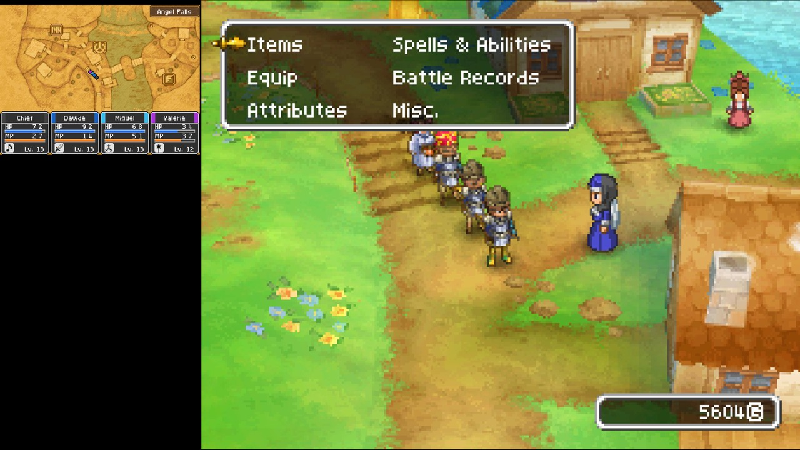
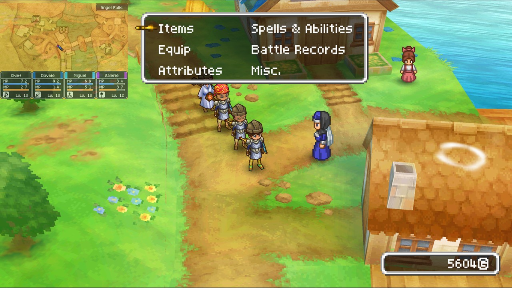
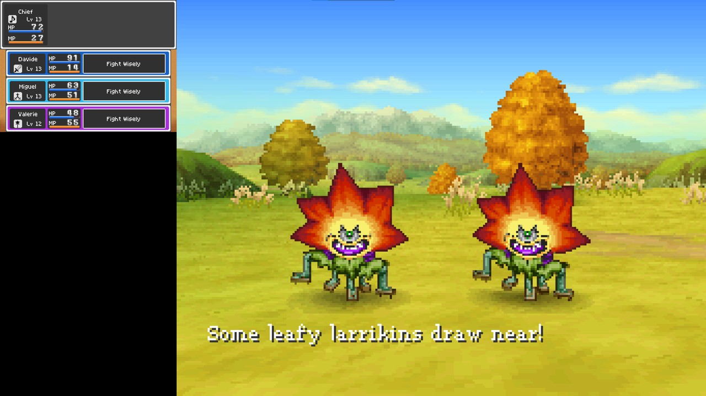
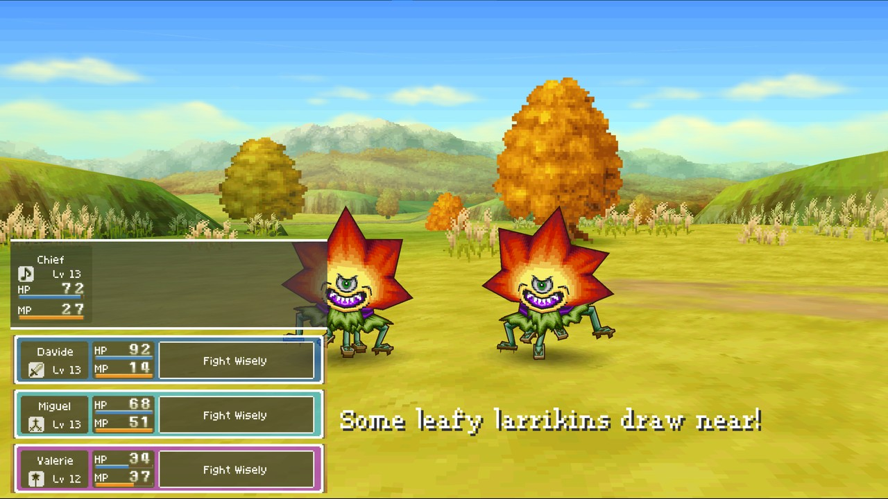
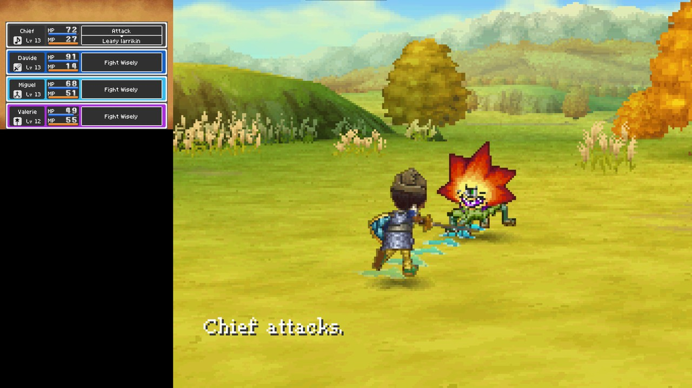
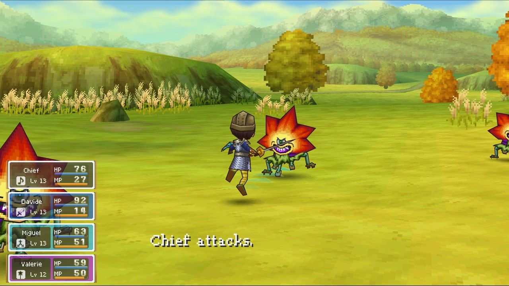
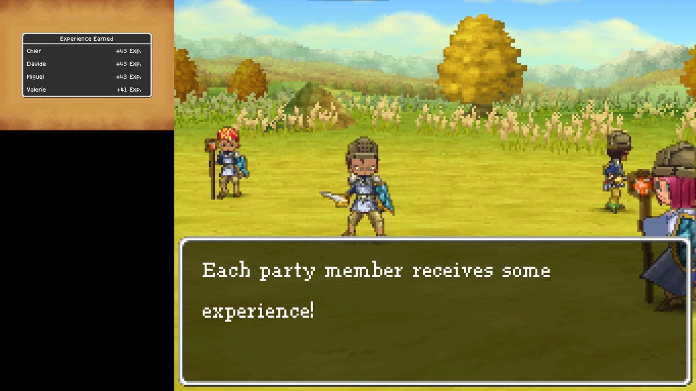
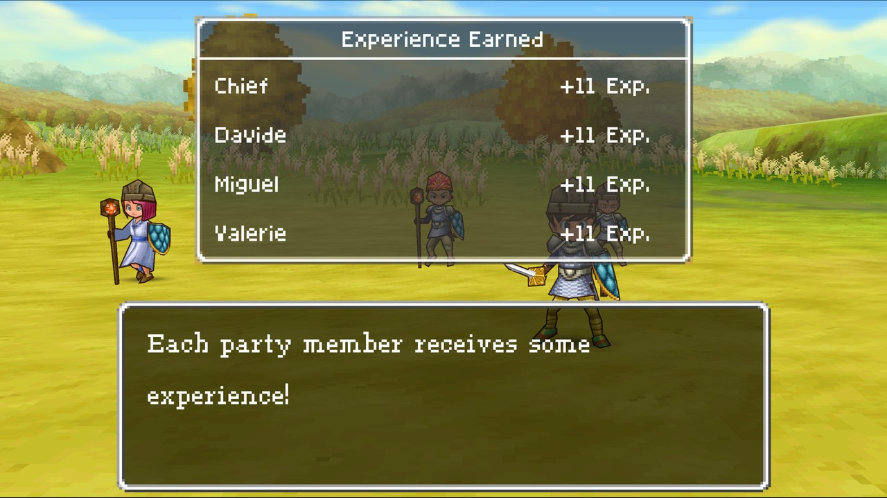

# DQIX Enhanced

**Dragon Quest IX: Sentinels of the Starry Skies, as a native PC game.**

This project turns your own copy of Dragon Quest IX (the USA or European DS
cartridge's ROM) into a real Windows program, built on your PC from your ROM. Nothing
from the game is included here: no code, no graphics, no music. It isn't an
emulator running the DS's code. The game's code has been recompiled into
native PC code, with the DS's hardware rebuilt around it. So it can play
exactly like the original, and it can also do things the DS never could.

**Project page:** https://github.com/MaErGa/dqix-enhanced-USAEUR (releases, questions and bug reports).

## Screenshots

Left: the game as on the DS. Right: Enhanced mode with Dynamic Widescreen
(Experimental), the 3D drawn at your monitor's resolution and wider than
the DS's screen.

<table>
<tr><th>Like the DS</th><th>Enhanced, Dynamic Widescreen</th></tr>
<tr>
<td></td>
<td></td>
</tr>
<tr><td colspan="2">Exploring: the field fills the screen, the map stays in the top left, and the game's own windows move right, clear of it.</td></tr>
<tr>
<td></td>
<td></td>
</tr>
<tr><td colspan="2">Choosing commands: the party's panels stacked in the bottom left over the battle, see-through with solid lines.</td></tr>
<tr>
<td></td>
<td></td>
</tr>
<tr><td colspan="2">While the attacks play: each panel shrinks to the name and HP/MP, and the battle messages move clear of them.</td></tr>
<tr>
<td></td>
<td></td>
</tr>
<tr><td colspan="2">After the battle: the experience window big and see-through over the scene.</td></tr>
</table>

## Features

**The game as it was**
- **Classic mode**: every frame exactly as a DS draws it, checked pixel for
  pixel against a reference DS emulator, with the DS's own sound and timing.
- Your whole adventure: the story, alchemy, grottoes, Quester's Rest, and
  the downloadable quests and special guests.
- Saves in the DS's own format, so they work with save editors and tools.

**Better than the DS**
- **Enhanced mode**: the 3D drawn on your graphics card at up to 12x the
  DS's resolution, or Auto: as sharp as your monitor shows it, and
  optional smooth textures. Switch between Classic and Enhanced at any
  time (F5).
- **The DS Lite look** (on at first): a screen filter with the DS Lite's
  colours, pixel grid, motion blur and backlight levels, and the screens
  inside a photo of a real DS Lite (or a drawn one in six colours), even at
  actual size. F6 switches the screen filter, F7 the console.
- Any window size, fullscreen, screens stacked or side by side, and sharp
  pixel scaling. F9 swaps the screens.
- **Two windows**, one screen in each, for two monitors, each one
  fullscreen if you like. In widescreen, the map can go in its own window
  so the field is clean.
- Keyboard, mouse (as the touch screen) and gamepads, every key and button
  changeable (Game > Controls). Tab turns fast forward on and off (a ▶▶▶ in the corner shows it; `fast_forward = hold` in settings.ini to hold it instead).
- Reset without closing the game, and a volume slider.
- The game's own icon (the one the DS menu shows), made from your ROM.

**Modern options** (in the Modern menu; with them all off, the game is the
original)
- **Walk in any direction with the left stick** (on at first): the stick
  steers like the DS stylus while you walk around, instead of the D-pad's 8
  directions (without the stylus's arrow on the screen).
- **Basic Widescreen**: the action drawn wider than the DS's screen, so you see
  more of the world left and right, with the other screen (the map, the
  battle commands) small in a corner: pick the corner, size and how
  see-through it is, also from a controller. 16:9 in a window, as wide as
  your monitor in fullscreen.
- **Dynamic Widescreen (Experimental)**: the field never moves; the map
  stays top left and the game's own windows move right, clear of it, with
  dialogue in the middle; screens of their own show 4:3; in battles the
  party's panels sit stacked in the bottom left.
- **Single screen**: one screen as big as it gets, switched with a trigger.
- **Top screen in the corner**: the same, with the field as on the DS.
- Coming: a free camera (see the roadmap).

**Multiplayer, from anywhere**
- **Tag mode** (canvassing for guests) and **co-op** (visiting and inviting
  through Pavo) with up to 4 players, over the internet: friends don't need
  to be in the same room.
- The game sets up your router by itself where it can (UPnP), and the host
  gets a window with the address to send to friends.

**DQVC and downloads, offline**
- **Sellma's DQVC shop is back**, with the original 52 weekly sales on their
  original calendar. New stock arrives every day, every player gets their
  own shop, and friends visiting your world can shop at yours.
- The downloadable quests arrive through Sellma like in 2010, from a small
  server built into the game: no internet connection or extra files needed.
- An option to unlock all downloadable quests and special guests at once.

**Easy to keep up to date**
- The game tells you when a new version is out and updates itself
  (Help > Check for updates). Choose *stable* (tested) or *nightly* (the
  newest work).
- F10 saves a bug report with a screenshot and everything needed to
  replay what happened.

## Getting started

You need your own Dragon Quest IX cartridge's ROM (`.nds`; the USA or
European version, others can be tried; the European one plays in the language
chosen in Game > Language), Windows 10 or 11 (64-bit), about 3 GB of free space, and the internet the
first time.

1. Download the latest **stable** release from the
   **Releases page** of this repository
   (*Source code (zip)*) and unzip it. The **Nightly** release there is the
   newest work, less tested.
2. Double-click **`Install Dragon Quest IX.bat`**. A setup window walks you
   through it: choose your ROM (the `.nds`, or a `.zip` with it inside; it
   says which version it is), where to put
   the game (your Documents by default), and shortcuts on the desktop and in
   the Start menu. It then installs the free build tools (MSYS2) and builds
   the game: 10-20 minutes the first time. Press **Play now** at the end.
3. Next time, start it from the desktop or the Start menu. It is listed in
   Settings > Apps, where it can be uninstalled (your saves are kept unless
   you say otherwise). To pin it to the taskbar, right-click the shortcut.

Prefer no window? Put your ROM in the `rom` folder and double-click
**`BUILD.bat`** instead; the game appears in the `game` folder
(`game\dqix.exe`).

**Already have MSYS2?** The installer finds it on any drive and only adds
what's missing. If it doesn't (an unusual place), put its folder (for
example `D:\tools\msys64`) in a file named `msys2-path.txt` next to
`BUILD.bat`. An old MSYS2 is updated or repaired; if it can't be, the
installer asks before installing a fresh one, and keeps the old one renamed.

Your save (`dqix.sav`) and settings (`settings.ini`) live in the `game`
folder. **Don't share the `game` or `build` folders**: they contain the game.

## Controls

| DS | Keyboard | Gamepad |
|---|---|---|
| D-pad | arrow keys | D-pad / left stick |
| A / B / X / Y | X / Z / S / A | right / bottom / top / left button (by position, on any controller) |
| L / R (turn the camera) | Q / W | shoulder buttons, or the right stick while walking |
| START / SELECT | Enter / Right Shift | Start / Back |
| touch screen | left mouse button on the bottom screen | |

Every setting is in the **menu bar** at the top of the window, and
**Game > Controls** changes any key or button. Handy keys: Tab (on/off) fast
forward, P pause, Ctrl+R reset, - / = volume, F5 Classic / Enhanced, F2
layout, U single screen, F9 swap the screens, K / I / O the widescreen small
screen's corner, size and opacity, F11 fullscreen (double-click outside the
touch screen to leave it), F12 screenshot, F10 bug report. On a controller:
the triggers for single screen and swap, the stick clicks for the small
screen's corner and opacity, Start+Select+L+R held to reset.

## Playing with friends

Everyone needs the same version of the game.

1. Save your adventure first: the game restarts for a session.
2. One player hosts: *Wireless > Play with friends far away > Host*. A window
   shows the address to send to your friends, with a Copy button.
3. The others choose *Join a friend* and paste that address.
4. When everyone is in the host's list, the host presses **Start the game**.

Then play as you would with DSes side by side: canvass for guests with
Erinn, or visit and invite through Pavo.

If friends can't connect, the host's router didn't open the port by itself.
Either forward TCP port 27900 to the host's PC, or all join a free virtual
LAN (Tailscale, ZeroTier or Radmin VPN) and use the host's address there.

## Languages

The menus and messages are in English and Spanish (**Interface language / Idioma** menu; the first
time it follows your system). The game's own text is a different thing: with the European ROM it is
chosen in *Game > Language* (English, French, German, Italian, Spanish; the first run follows your
system). Translators: see [docs/TRANSLATING.md](docs/TRANSLATING.md).

Also in this version: *Game > Speed of the fast forward* (2x, 4x or unlimited; `fast_speed` in
settings.ini), the installer and uninstaller in Spanish when Windows is, and, in a session, the
console of the other players is not drawn (it is never looked at), which is most of what it would
cost your CPU.

## Updating

The game checks for a new stable version when it starts and asks before
changing anything. *Help > Check for updates* shows both the stable and the
nightly version, so you can choose either. An update downloads the new
version of this project, builds the game again from your ROM, and restarts.
Your saves and settings are kept, and the previous version is kept
in the `update` folder (`update\rollback.bat` goes back to it).

To update by hand (a newer version you downloaded), unzip it anywhere and double-click
**`Update Dragon Quest IX.bat`**: it finds the installed game (or asks where it is), copies the new
files over it, builds again, and keeps your saves, settings and ROM. The installer window shows the
progress.

The game updates from this repository (`UPDATE_REPO` in `runtime/update.h`): it reads `runtime/version.h`
from its `stable` and `main` branches, so both branches have to exist.

## What's next

The plans (more multiplayer options, hand-written DQVC news, widescreen and
more) are in [ROADMAP.md](ROADMAP.md).

## If something goes wrong

Press **F10** in the game: it saves a report in `game\reports\` with a box
to describe what happened. For multiplayer problems, also include
`game\session\front.log`.

Questions, or stuck? Open an issue at https://github.com/MaErGa/dqix-enhanced-USAEUR/issues.

## About this project

DQIX Enhanced (USA and EUR) is based on the open-source project *dqix-enhanced* (GPL-3.0-or-later), and
it is distributed under the same license (see LICENSE). It was modified in 2026: it adds the Spanish
interface (and the way to add more languages), the translated installer and uninstaller, the
*Update Dragon Quest IX.bat* updater, the fast-forward speed menu, and the speed-ups for sessions.

The function names and boundaries come from the public-domain Dragon Quest
IX decompilation project. The wireless chip, the 3D renderer and the sound
follow the melonDS emulator's research. How everything fits together, and
the tools for testing, are in [docs/TECHNICAL.md](docs/TECHNICAL.md).

Dragon Quest IX is © Square Enix / Level-5 / Armor Project / Bird Studio /
Koichi Sugiyama. This project isn't affiliated with or endorsed by Square
Enix or Nintendo. It contains no game files, and it only works with a ROM
you dumped from your own cartridge.

Licence: GPL-3.0-or-later (see `LICENSE`). It includes public-domain data
from the DQIX decompilation project (`config/`), libslirp (BSD,
`third_party/libslirp`), stb_truetype, stb_image and stb_vorbis (public
domain), dr_flac (public domain / MIT-0), and translated
parts of melonDS (GPL-3.0-or-later).
